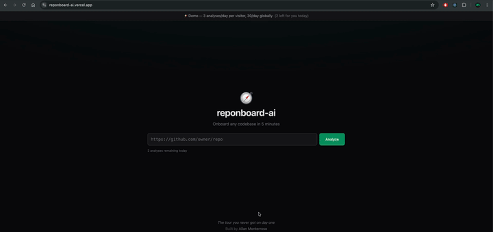
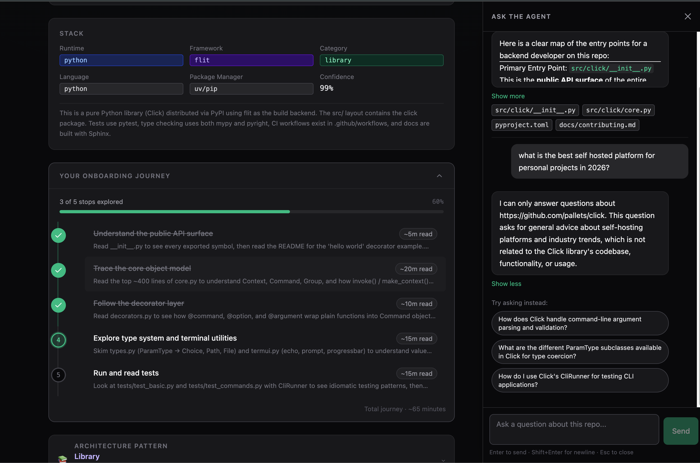
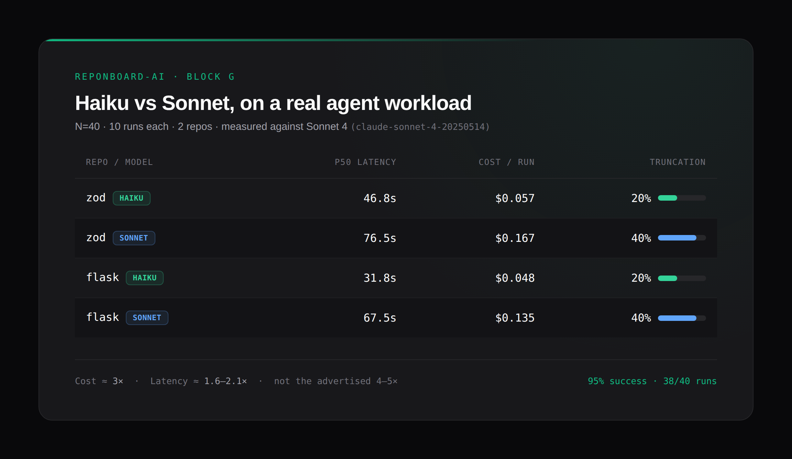

# 🧭 reponboard-ai

> **AI-powered onboarding agent** — Reponboard any codebase in 5 minutes

The codebase tour you never got.

[](https://reponboard-ai.vercel.app)
[](LICENSE)



---

## 🎯 What It Does

An AI agent that analyzes any GitHub repo and turns it into a guided onboarding experience.

Paste a GitHub URL → Get an instant breakdown:

- **Executive Summary** — What this codebase does in 2 paragraphs
- **Architecture Pattern** — Detected pattern (Monolith, Monorepo, MVC, Layered, Event-Driven, Serverless, Jamstack, Library, …) with a rich descriptive subtitle
- **Your Onboarding Journey** — Interactive timeline of stops to follow, with checkmarks, progress bar, time estimates, and clickable file paths
- **Stack & Key Files** — Refined tech stack with reasoning, plus a categorized list of the files that matter and why
- **Interactive Q&A** — Floating chat to ask anything about the analyzed repo

---

## 🚀 Live Demo

**[https://reponboard-ai.vercel.app](https://reponboard-ai.vercel.app)**

> The demo is rate-limited to **30 analyses/day globally** and **3/day per IP** to keep hosting free. If you hit the limit, check back tomorrow or run it locally with your own API key.

---

## ✨ Features

- **Onboarding Journey** — Interactive timeline of stops with progress tracking, time estimates, and clickable GitHub links.
- **Architecture Detection** — Identifies the pattern (monolith, monorepo, microservices, MVC, layered, event-driven, serverless, jamstack, library) with a descriptive subtitle.
- **AI Lab** — A live pane beside the results that streams the agent's run as it happens: every model call (stage, model, latency, tokens, % served from prompt cache, cost, reasoning summary) and every tool call, plus running totals.
- **Intent-based Model Routing** — `fast` (Claude Haiku 5.5) and `quality` (Claude Sonnet 5.5) intents. Benchmarked twice on the same protocol: Block G (May 2026, previous generation) and Block H (Oct 2026, Claude 5.5).
- **Instant repeat analyses** — Results are cached per repo + commit SHA; a repeat analysis replays the stored result and trace in under a second at zero LLM cost.
- **Stack Refinement** — Heuristic stack detection refined by Claude with reasoning you can read.
- **Key Files Summary** — Categorized file list annotated with what each file does and why it matters.
- **Interactive Q&A with Defense-in-Depth** — Floating chat drawer where a ReAct agent uses Claude tool_use to fetch files on demand. Four layers of defense (system prompt invariant, pre-flight classifier, post-hoc validator, structured observability) prevent multi-turn guardrail decay and hallucinated file references. Off-topic questions are declined with clickable suggestions for repo-scoped questions instead.
- **Markdown + Syntax Highlighting** — Q&A answers render with full markdown, Prism syntax highlighting for 10 languages, and inline file paths auto-linked to GitHub.
- **Resilient Error Handling** — Anthropic 529/503/network errors retry with exponential backoff; if exhausted, the UI surfaces a friendly fallback with a Retry button instead of raw error JSON.
- **Structured Observability** — Every Q&A request emits one [qa-telemetry] JSON log line with classification, cost, latency, validator outcomes, retries, and fatal errors.



---

## 🏗️ How It Works

```
GitHub URL
    │
    ▼
┌─────────────────────┐
│  1. DISCOVERY       │  Fetch repo tree, detect stack, find entry points
└─────────────────────┘
    │
    ▼
┌─────────────────────┐
│  2. LLM ANALYSIS    │  ReAct agent (Claude tool_use) explores files
└─────────────────────┘
    │
    ▼
┌─────────────────────┐
│  3. GUIDE OUTPUT    │  Summary, pattern, journey, key files
└─────────────────────┘
    │
    ▼
┌─────────────────────┐
│  4. INTERACTIVE Q&A │  On-demand follow-up questions about the repo
└─────────────────────┘
```

### Tech Stack

| Layer | Tech |
|-------|------|
| Frontend | Next.js 15 (App Router, RSC), TypeScript strict, Tailwind CSS |
| UI primitives | shadcn/ui, lucide-react icons |
| AI Agent | Claude API, `@anthropic-ai/sdk` 1.x (Haiku 5.5 fast tier + workers, Sonnet 5.5 quality tier) |
| Repo Parsing | GitHub REST API (tree endpoint, no cloning) |
| Streaming | Server-Sent Events (typed events, ids, heartbeat) |
| Cache + rate limits | Upstash Redis |
| Monorepo | pnpm workspaces |
| Deploy | Vercel Functions (Node.js / Fluid Compute) + daily cron |

---

## 🏛️ Architecture Highlights

- **Two-layer analysis pipeline** — Layer 1 (`discovery.ts`) does fast heuristic detection without any LLM call. Layer 2 (`llm-analysis.ts`) calls Claude only on the highest-value files, controlling cost and latency.
- **Q&A Defense-in-Depth** — Four layers (system prompt / classifier / validator / observability) reduce off-topic query cost from ~$0.023 to ~$0.001 (22x reduction) and eliminate hallucinated file references.
- **Intent-based LLM routing** — `fast` (Haiku) vs `quality` (Sonnet) intent per request, with empirical benchmark informing the tradeoff. Sonnet is not strictly better: truncation rate is actually higher on Sonnet (40%) than Haiku (20%) on this workload, which is why defensive coercion is a first-class concern.
- **ReAct agent with tool_use** — Both pipelines use Claude's tool_use API with bounded tool calls. `finish_core`, `finish_guide`, and `respond` are themselves **strict** tools, so the API guarantees schema-valid output.
- **Modern agent patterns** — prompt caching across the loop (and across the two analysis phases, which share one tool list), parallel tool calls, an orchestrator–worker fan-out (Haiku 5.5 workers summarize secondary files in parallel), adaptive thinking with per-route effort, and budget steering through mid-conversation system messages instead of forced `tool_choice` (which Sonnet 5.5 rejects).
- **SSE streaming + agent trace** — `/api/analyze` and `/api/qa` stream typed Server-Sent Events, including `llm_call` and `tool_end` trace events that power the AI Lab. One reducer drives both the results view and the Lab.
- **Code-split UI** — the results view, AI Lab, and Q&A chat are `React.lazy` + `Suspense` chunks with skeleton fallbacks: `/` first-load JS went from 189 kB to 123 kB.
- **Upstash Redis rate limiting with env isolation** — Keys prefixed with environment (`prod:` / `preview:` / `dev:`) let local development share an Upstash DB with production without polluting counters.
- **Structured telemetry** — Every Q&A request emits one [qa-telemetry] JSON line with classification, cost, latency, validator outcomes, retries, and fatal errors. Read from Vercel logs.
- **Reusable agent-core package** — Agent logic lives in `packages/agent-core` independent of Next.js for future CLI, Slack bot, or other surfaces.

---

## 📊 Benchmark

The pipeline is benchmarked on a fixed protocol: `colinhacks/zod` and `pallets/flask`, `fast` and `quality` tiers, N=10 each. Methodology and caveats are in [BENCHMARK_NOTES.md](BENCHMARK_NOTES.md).

**Block H (Oct 2026, Claude 5.5 + agent patterns) vs Block G (May 2026, Haiku 4.5 / Sonnet 4.6):**

| Quadrant | p50 latency | Cost / analysis | Truncation |
|---|---|---|---|
| zod · fast | 46.8s → **26.7s** | $0.057 → **$0.0059** | 20% → **0%** |
| zod · quality | 76.5s → **23.9s** | $0.167 → **$0.070** | 40% → **0%** |
| flask · fast | 31.8s → **20.5s** | $0.048 → **$0.0026** | 20% → **0%** |
| flask · quality | 67.5s → **23.2s** | $0.135 → **$0.048** | 40% → **0%** |

Headline findings:
- **~3× faster on the quality tier, 58–95% cheaper**, with 40/40 successful runs (Block G: 38/40).
- **Truncation eliminated** — strict tool use guarantees the structured payload; Block G's "truncation" turned out to be the model dropping schema fields, not running out of tokens.
- **64–88% of input tokens served from the prompt cache.**
- **The quality tier is no longer the slow tier**: Sonnet 5.5 matches Haiku 5.5 on wall-clock because it explores less; the tiers now differ mainly on cost (~12–19×).

Block G's original finding still shaped the design: premium models are not strictly better, so routing is per intent and defensive coercion stays as a backstop.



---

## 📈 Observability

Every Q&A request emits one structured JSON line to stdout:

```json
{
  "requestId": "...",
  "timestamp": "...",
  "repoUrl": "...",
  "questionLength": 41,
  "questionHashPrefix": "66113702",
  "classification": "on_topic",
  "classifierConfidence": 0.95,
  "classifierLatencyMs": 1162,
  "classifierDegradedMode": false,
  "toolCallsUsed": 2,
  "toolBudgetExhausted": false,
  "hallucinatedFileReferences": [],
  "responseRejectedByValidator": false,
  "retryCount": 0,
  "finalCostUsd": 0.013489,
  "finalLatencyMs": 9859,
  "historyLength": 1,
  "fatalError": null
}
```

Grep Vercel logs by `[qa-telemetry]` prefix. Useful queries:
- `classifierDegradedMode: true` → classifier failures
- `responseRejectedByValidator: true` → validator catches
- `finalCostUsd > 0.05` → expensive queries to investigate
- `fatalError != null` → unrecoverable errors

Persistent storage in Neon Postgres planned in Tier 2.

---

## 💻 Run Locally

```bash
# Clone the repo
git clone https://github.com/aamonterroso/reponboard-ai.git
cd reponboard-ai

# Install dependencies (requires pnpm)
pnpm install

# Set up environment variables
cp .env.example .env.local
# Edit .env.local and add your ANTHROPIC_API_KEY

# Start the dev server
pnpm dev
```

Open [http://localhost:3000](http://localhost:3000) and paste any public GitHub URL.

### Environment Variables

```bash
# .env.local
ANTHROPIC_API_KEY=sk-ant-...   # Required — get one at console.anthropic.com
GITHUB_TOKEN=ghp_...           # Optional — increases GitHub rate limit 60 → 5000/hr
LLM_MODEL_INTENT=fast          # fast (Haiku 5.5) | quality (Sonnet 5.5)
```

---

## 📁 Project Structure

```
reponboard-ai/
├── apps/
│   └── web/                          # Next.js application
│       ├── app/
│       │   ├── api/
│       │   │   ├── analyze/route.ts  # POST — SSE analysis + repo@SHA cache
│       │   │   ├── qa/route.ts       # POST — streaming Q&A (classifier
│       │   │   │                     # pre-flight, validator post-hoc,
│       │   │   │                     # telemetry emission)
│       │   │   ├── remaining/route.ts # GET — daily quota left
│       │   │   └── keepalive/route.ts # GET — daily cron (CRON_SECRET)
│       │   └── page.tsx              # Landing + result view
│       ├── hooks/use-analysis-stream.ts # SSE request → reducer
│       ├── lib/                        # sse, sse-client, analysis-stream
│       │                               # reducer, analysis-cache, rate-limit
│       └── components/
│           ├── analysis-result.tsx     # Result page (Journey, Stack, etc.)
│           ├── url-input.tsx           # Input form + results / AI Lab layout
│           ├── ai-lab/ai-lab-panel.tsx # Live agent trace
│           └── qa-chat.tsx             # Floating Q&A drawer (markdown,
│                                      # suggestion chips, error fallback)
├── packages/
│   └── agent-core/                   # Reusable agent logic
│       └── src/
│           ├── anthropic-retry.ts      # 529/503/network retry helper
│           ├── discovery.ts            # Layer 1 — heuristic detection
│           ├── llm-analysis.ts         # Layer 2 — ReAct agent (tool_use)
│           ├── full-analysis.ts        # Orchestrator (generator stream)
│           ├── file-workers.ts         # Haiku worker fan-out
│           ├── trace.ts                # AI Lab trace events
│           ├── qa.ts                   # Q&A ReAct agent
│           ├── qa-classifier.ts        # Pre-flight classifier (Haiku 5.5)
│           ├── qa-validator.ts         # Post-hoc validator (hallucination
│           │                           # + recap detection)
│           ├── qa-telemetry.ts         # Structured observability emitter
│           └── types.ts                # Shared types
├── benchmark-results/
│   ├── block-g-final-canonical/      # May 2026: Haiku 4.5 vs Sonnet 4.6
│   └── block-h-2026-10-27/           # Oct 2026: Haiku 5.5 vs Sonnet 5.5
├── BENCHMARK_NOTES.md                # Benchmark methodology
└── CLAUDE.md                         # Architecture / contribution guide
```

---

## ⚙️ Guardrails

| Guardrail | Details |
|-----------|---------|
| URL validation | Only accepts `github.com/<owner>/<repo>` URLs |
| Rate limiting | Upstash Redis: 30 analyses/day globally, 3/day per IP, daily TTL, env-prefixed keys; fails closed (503) if Redis is unreachable |
| Q&A guardrail | Four-layer defense-in-depth (system prompt + classifier + validator + observability) |
| Q&A scope | Off-topic questions declined with clickable suggestions; classifier short-circuits before ReAct |
| SDK retry | 3 attempts × exponential backoff on 529/503/network errors |
| Error UI | Friendly fallback with Retry button; never exposes raw error JSON |
| Cost protection | Max 12 key files to LLM in analysis; classifier short-circuits off-topic at ~$0.001 |
| Timeouts | 120s analysis cap; 60s per Anthropic call; 15s per GitHub request; classifier 12s with retry |
| Keepalive | Daily Vercel cron keeps the Upstash DB active (it was once archived for inactivity) |

### Deployment on Vercel

The demo runs on Vercel's Hobby plan as Node.js functions on Fluid Compute (`maxDuration = 300`), streaming SSE with a heartbeat so long model calls never look idle to proxies. The agent code lives in `packages/agent-core` and is runtime-agnostic, so porting to another host is mostly mechanical.

---

## 🛠️ Development Commands

```bash
pnpm dev          # Start dev server (http://localhost:3000)
pnpm build        # Production build
pnpm typecheck    # Type checking
pnpm lint         # Linting
pnpm test         # vitest (agent-core + web)
pnpm bench --repo zod --intent quality --runs 10   # benchmark harness
```

---

## 🗺️ Roadmap

**Just shipped (Oct 2026 modernization):**
- Claude 5.5 models + SDK 1.x; prompt caching, strict tools, parallel tool calls, orchestrator–worker fan-out
- AI Lab live agent trace over SSE
- Analysis cache by repo + commit SHA
- Code-split UI with Suspense skeletons, self-hosted fonts
- Upstash keepalive cron, fail-closed Redis, request timeouts everywhere
- Q&A empty-answer and ignored-budget fixes
- Block H benchmark (N=40) on Claude 5.5

**Shipping next:**
- Model selector in the AI Lab
- Validator retry feedback streamed to UI
- Neon Postgres + Drizzle for persistent telemetry
- Shareable analysis links `/analysis/{id}` with OG previews
- CLI hybrid (`npx reponboard <url>` + browser open)

**Exploring:**
- PR/Commit Timeline Analyzer ("what changed while you were away")
- Slack delivery for engineering channel reports

---

## 📄 License

MIT © [Allan Monterroso](https://github.com/aamonterroso)

---

Powered by [Claude](https://anthropic.com). Built because every dev deserves a proper codebase tour.
